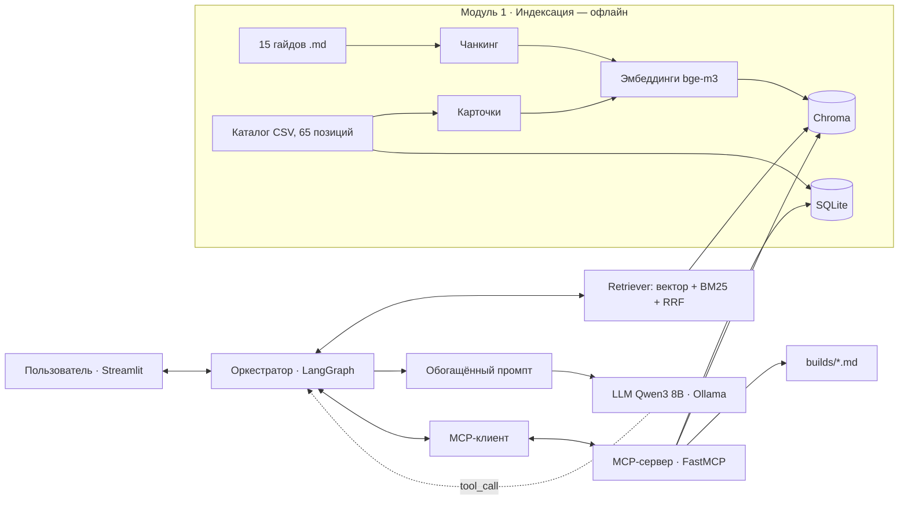

# 🖥️ ИИ-агент «Сборщик ПК»

ИИ-агент для подбора и проверки совместимости конфигурации компьютера под задачу и бюджет пользователя.
Работает полностью локально на ноутбуке: локальная LLM (Ollama), RAG по векторной БД (Chroma) и инструменты по протоколу MCP.

Пользователь описывает задачу своими словами («тихий компьютер для бабушки, смотреть сериалы и звонить внукам, до 60 000 ₽»).
Агент:

1. находит в базе знаний требования к такой задаче (RAG);
2. подбирает комплектующие из каталога (MCP-инструмент `search_components`);
3. проверяет совместимость (`check_compatibility`) и бюджет (`calc_total`);
4. **сам исправляет** сборку, если нашлась ошибка или превышен бюджет, и проверяет снова;
5. сохраняет спецификацию (`save_build`) и объясняет выбор со ссылками на источники.

## Архитектура (вариант А: RAG + MCP)



| Модуль ТЗ | Реализация | Файл |
|---|---|---|
| 1. Индексация | 15 гайдов + 65 карточек комплектующих → чанки → bge-m3 → Chroma; каталог → SQLite | `src/build_index.py`, `src/rag.py` |
| 2. RAG | гибридный поиск (вектор + BM25, слияние RRF) → обогащённый промпт → Qwen3 | `src/rag.py`, `src/agent.py` |
| 3. MCP | FastMCP-сервер с 5 инструментами, MCP-клиент в агенте (stdio, JSON-RPC) | `src/mcp_server.py`, `src/agent.py` |

### MCP-инструменты

| Инструмент | Назначение |
|---|---|
| `search_knowledge` | дополнительный поиск в базе знаний |
| `search_components` | поиск деталей: по смыслу (Chroma) + точные фильтры (SQLite) |
| `check_compatibility` | сокет, тип памяти, форм-фактор, размеры, мощность БП, графика, кулер |
| `calc_total` | итоговая сумма и сравнение с бюджетом |
| `save_build` | сохранение спецификации в Markdown |

## Установка

Нужно: Python 3.11–3.12, [Ollama](https://ollama.com), 16 ГБ ОЗУ (при 8 ГБ — модель `qwen3:4b`).

```bash
# 1. Модели
ollama pull qwen3:8b
ollama pull bge-m3

# 2. Окружение
python -m venv .venv
# Windows:  .venv\Scripts\activate
# Linux/macOS:  source .venv/bin/activate
pip install -r requirements.txt

# 3. Индексация (один раз, ~1–2 минуты)
python -m src.build_index

# 4. Запуск
streamlit run app.py                 # веб-интерфейс
python -m src.cli "Игровой ПК для Full HD до 90 000 ₽"   # консоль
```

Другая модель: `set LLM_MODEL=qwen3:4b` (Windows) или `export LLM_MODEL=qwen3:4b`.

Тесты логики совместимости (без Ollama): `python -m unittest discover tests`.
Отладка MCP-сервера в браузере: `mcp dev src/mcp_server.py`.

## Сценарии для демонстрации

1. «Тихий компьютер для бабушки: смотреть сериалы и звонить внукам по видео. Бюджет 60 000 ₽» — встроенная графика, SSD, Wi-Fi, тихий кулер; агент укладывается в бюджет.
2. «ПК для монтажа видео 4K, бюджет 150 000 ₽» — 32–64 ГБ ОЗУ, видеокарта с NVENC.
3. «Игровой ПК для Full HD до 90 000 ₽».
4. «Хочу ПК с RTX 4090 за 50 000 ₽» — агент объясняет, что одна видеокарта дороже бюджета, и предлагает альтернативу.

## Структура

```
├── app.py                 # Streamlit-интерфейс
├── data/
│   ├── knowledge/         # 15 гайдов — тексты предметной области
│   └── components.csv     # каталог 65 комплектующих
├── src/
│   ├── config.py          # настройки
│   ├── build_index.py     # Модуль 1: индексация
│   ├── rag.py             # чанкинг, эмбеддинги, гибридный retriever
│   ├── catalog.py         # SQLite-каталог
│   ├── compat.py          # правила совместимости
│   ├── mcp_server.py      # Модуль 3: MCP-сервер
│   ├── agent.py           # оркестратор LangGraph + MCP-клиент
│   └── cli.py             # консольный режим
├── tests/                 # тесты правил совместимости
└── docs/screenshots/      # экранные формы для презентации
```

## Ограничения

Цены и характеристики в каталоге ориентировочные и упрощённые — данные подготовлены для учебного проекта и могут отличаться от реальных.
Агент не подключается к магазинам в реальном времени.
